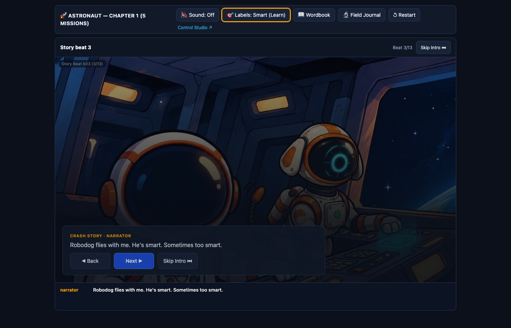
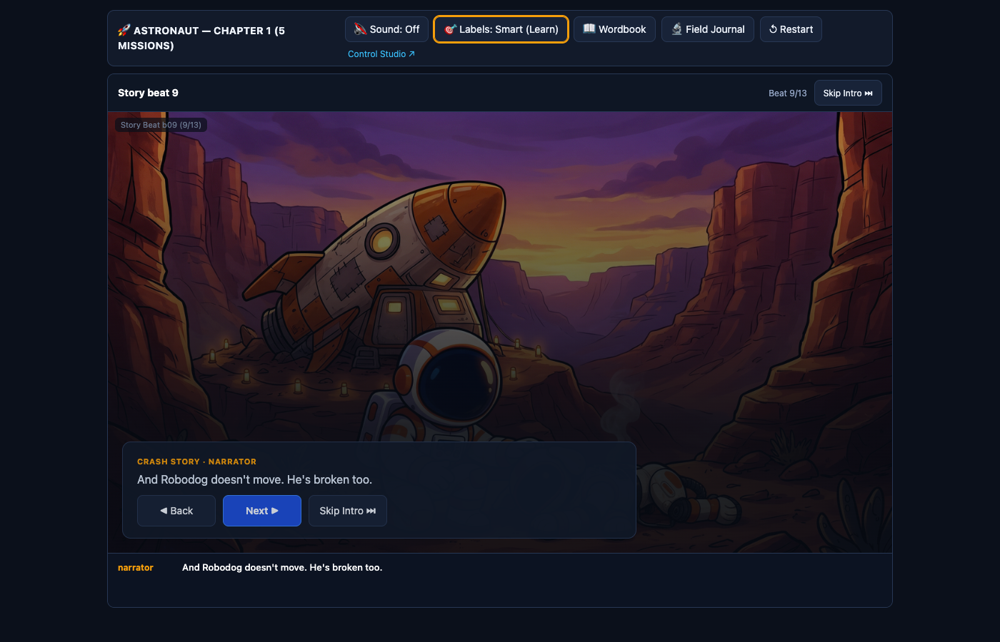
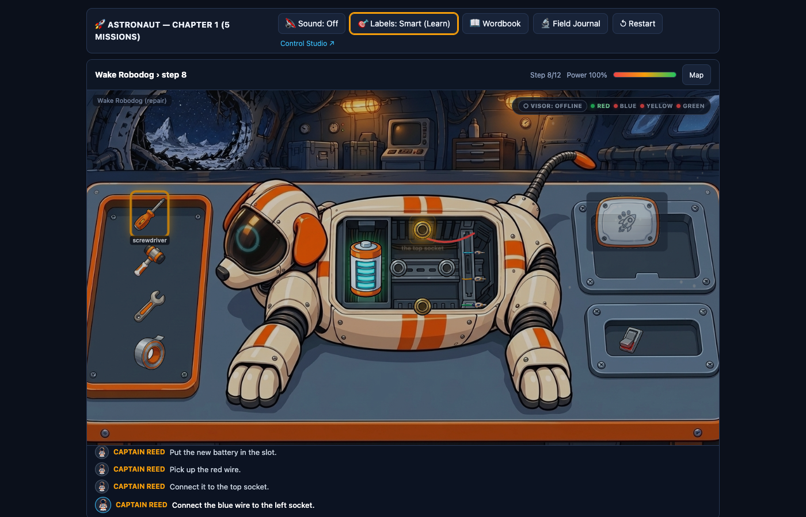
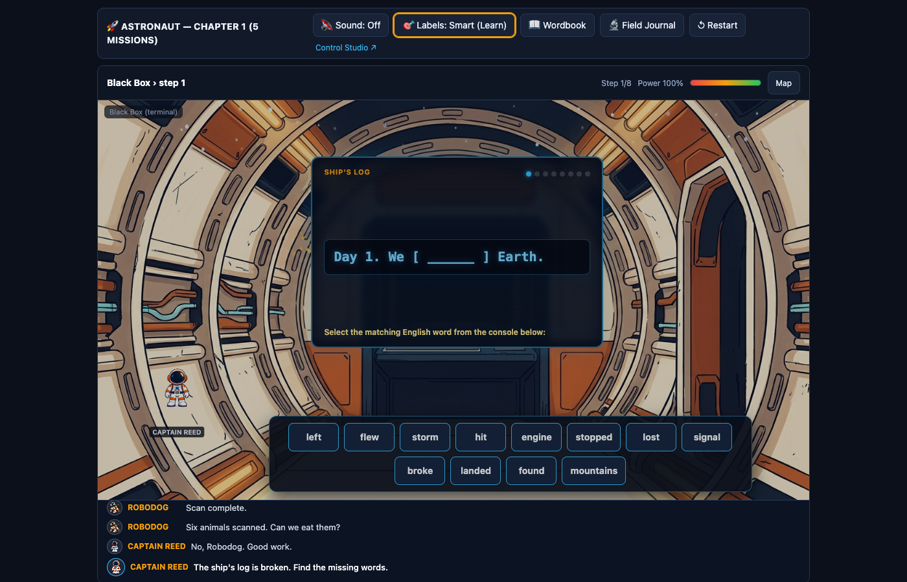
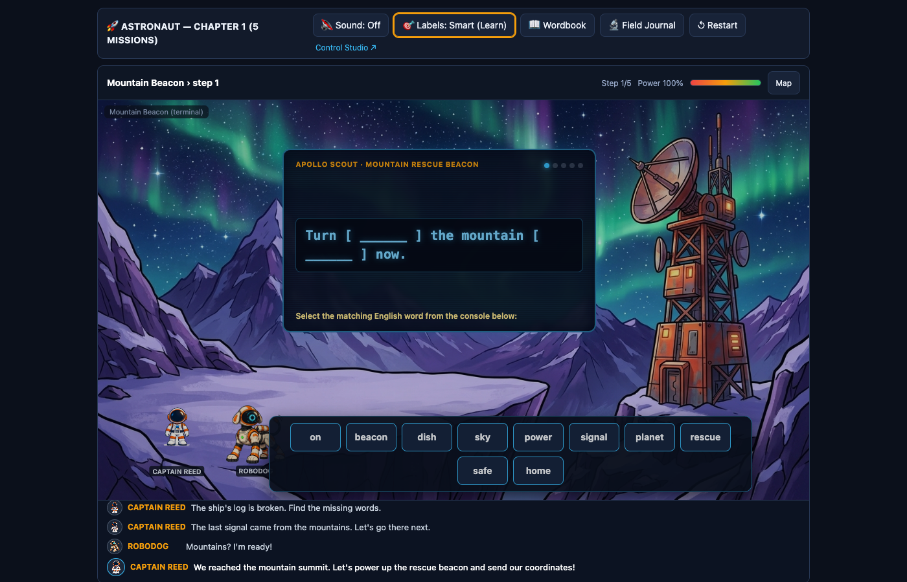
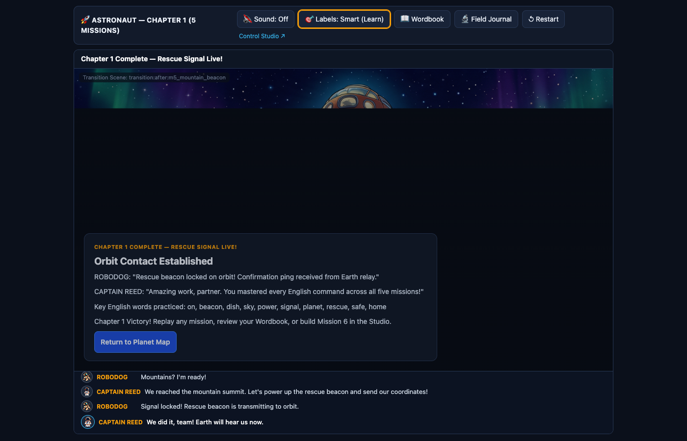
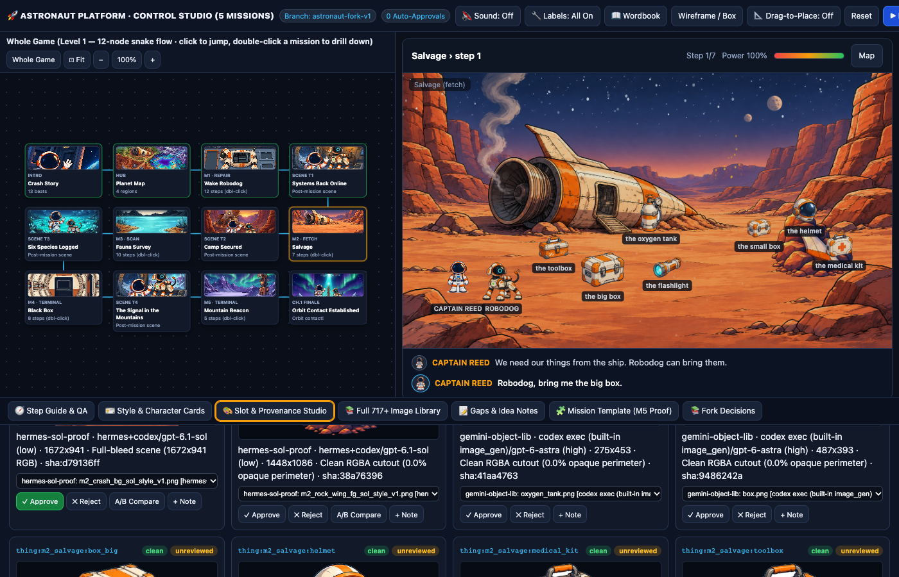
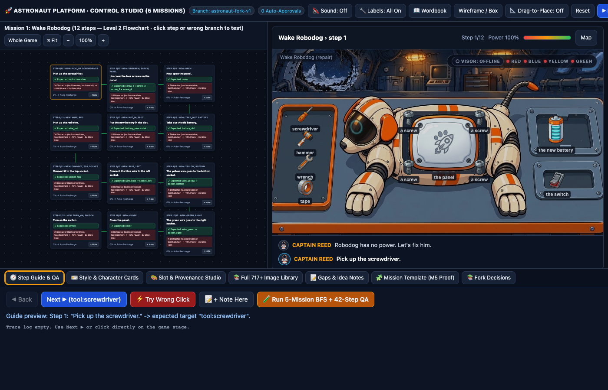
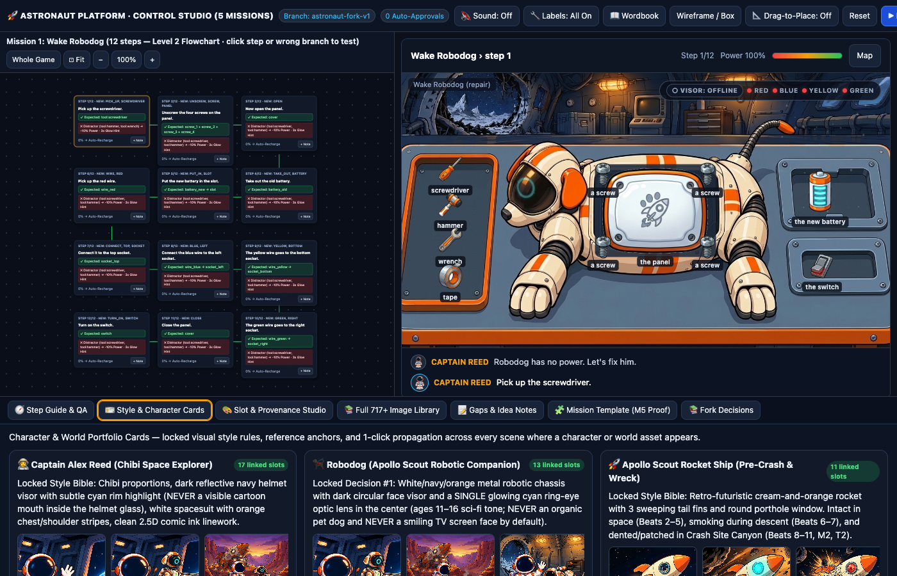
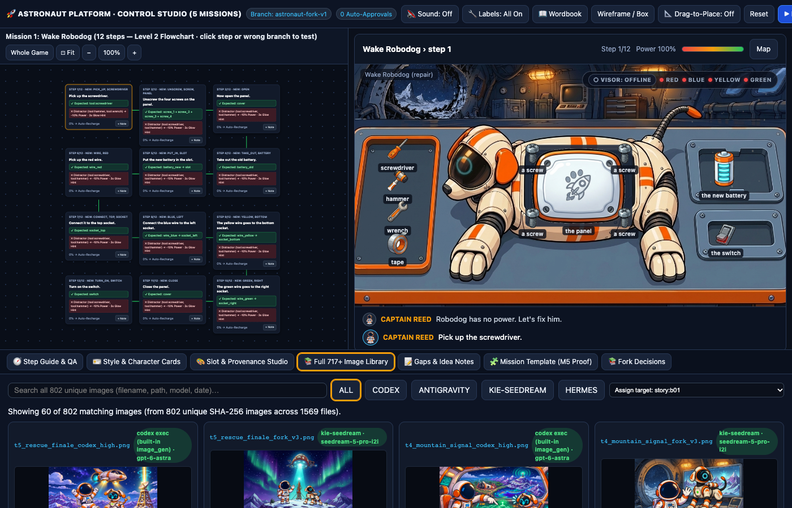

# 🚀 Astronaut — Chapter 1 (5-Mission English Learning Game & Control Studio)

**Astronaut** is a 2.5D comic sci-fi English-learning adventure game and visual production studio. Players help **Captain Alex Reed** and his robotic co-pilot **Robodog (Apollo Scout)** survive a crash landing on an unknown alien planet by understanding spoken and written English commands, repairing circuits, salvaging equipment, scanning alien wildlife, reconstructing the ship's black box log, and powering up the mountain rescue beacon.

---

## 🎮 Live Playable Links

| Surface | Purpose | Direct Link |
| :--- | :--- | :--- |
| **📖 Overview & Screenshot Tutorial (`index.html`)** | Human-readable summary of what was built, what was added in Fork v3, and a visual step-by-step guide | [Open Overview & Tutorial](./index.html) |
| **🕹️ Standalone Player Game (`game.html`)** | Clean, distraction-free player view with **Smart (Learn) Labels**, **Wordbook**, **Field Journal**, and optional **Voice/BGM Audio** | [▶ Play Astronaut Chapter 1](./game.html) |
| **🎛️ Control Studio & Dev Platform (`studio.html`)** | Two-level interactive flowchart canvas, live playable stage, **Character & World Style Cards**, **Slot & Provenance Studio**, and **802-Image Library Browser** | [🔧 Open Control Studio](./studio.html) |

---

## ✨ What Is Done & What Was Added (Human-Readable Summary)

### 1. Complete 5-Mission Playable Campaign (42 Interactive Steps + 5 Narrative Cutscenes)
- **Intro Story (13 Cohesive 2.5D Color Comic Beats):** Sets up Captain Alex Reed and Robodog's departure from Earth, the asteroid storm, the crash into the red canyon, low oxygen/power, and the call for an English-speaking partner.
- **Planet Hub Map (4 Unlockable Biomes):** Interactive regional progression across *Crash Site*, *Alien Lake*, *Ship Core*, and *Mountains*.
- **Mission 1 — Wake Robodog (Repair Mechanic · 12 Steps):** Open Robodog's chest maintenance bay using the right tools from the workbench tray, replace the dead battery, drag and snap 4 color-coded live sagging Bezier cables to their matching directional sockets (`top`, `bottom`, `left`, `right`), close the cover, and flip the power switch to light up Robodog's cyan ring-eye visor.
- **Mission 2 — Salvage the Camp (Fetch Mechanic · 7 Steps):** Command Robodog to dash across the crash site canyon and retrieve specific supplies (`the big box`, `the small box`, `the oxygen tank`, `the medical kit`, `the helmet`, `the toolbox`, `the flashlight`).
- **Mission 3 — Alien Lake Fauna Survey (Scan Mechanic · 10 Steps):** Identify and laser-scan 6 animated alien creatures (`flyer`, `swimmer`, `runner`, `grazer`, `sleeper`, `hider`) by their English action verbs and physical traits, logging each species in the **Alien Lake Field Journal**.
- **Mission 4 — Ship Core Black Box (Terminal Mechanic · 8 Steps):** Reconstruct Captain Reed's damaged Ship's Log inside the cockpit CRT monitor bezel using the docked English word-bank keypad.
- **Mission 5 — Mountain Rescue Beacon (Pure JSON Mission Template Proof · 5 Steps):** Power up the summit radio dish under the aurora sky and transmit rescue coordinates to orbit—authored 100% via a declarative JSON Mission Template (`fork/data/m5_mountain_beacon.json`) with **zero engine code edits**.
- **5 Post-Mission Transition Cutscenes (`T1`–`T5`):** Full-screen narrative milestones culminating in the Chapter 1 Rescue Finale.

---

### 2. What Was Added & Upgraded in Fork v3

#### 🎨 Layer 1 — Visual & Narrative Coherence
- **Cohesive 2.5D Color Comic Intro (`b01`–`b13`):** Replaced legacy black-and-white trailer sketches with 11 newly generated widescreen color 2.5D comic panels matched directly to each story beat's text and anchored to `panel_01.jpg`. (All original film panels remain selectable in the Studio for A/B comparison.)
- **Lying-Robodog Repair Workbench (`M1`):** Replaced the empty flat metal hatch with Robodog lying across the spacecraft workbench with his open chest repair cavity centered for interactive wiring, a vertical recessed tool tray on the left, battery/switch bays on the right, and a live `◉ ROBODOG VISOR: OFFLINE / READY / AWAKE` status indicator.
- **Clean Character-Free Mountain Summit (`M5`):** Removed baked-in duplicate background characters from the Mission 5 mountain backdrop so the live animated Captain Reed and Robodog sprites stand cleanly beside the radio tower.
- **Locked Apollo Scout Ring-Eye Robodog Across All Transitions (`T1`–`T5`):** Unified Robodog's appearance around the glowing cyan ring-eye optic lens (and dark reflective helmet glass on Captain Reed) across every cutscene, while keeping legacy screen-face variants one click away in the Studio.

#### 🎓 Layer 2 — Gameplay & English-Learning Core Polish
- **3-Mode Smart Label System:**
  - `🎯 Labels: Smart (Learn)` *(Default in `game.html`)* — Hides floating English item labels under unclicked targets so players actually read/listen to the English prompt instead of matching text tags; reveals labels on hover, click, or after 3 mistakes (when the gold hint glow activates).
  - `🎓 Labels: Study (On Mistake)` — Reveals the target label after 1 mistake.
  - `🔧 Labels: All On` *(Default in `studio.html`)* — Always displays all object labels for rapid inspection and QA.
- **Fitted Cockpit & Holo Terminal Bezels (`M4` & `M5`):** Framed the fill-in-the-blank sentences inside a high-contrast dark monitor screen with glowing cyan phosphor text and docked the word-bank buttons at the bottom of the stage so background art is never obscured.
- **2.5D Patrol Motion & Ambient FX:** Horizontal patrol loops with direction flips for the Alien Lake `flyer` and `swimmer`, ambient HTML5 Canvas particles (stars, rocket smoke wisps, sparks, water shimmer, canyon dust), and pointer parallax.

#### 🎛️ Layer 3 — Control Studio & Game Dev Platform (`studio.html`)
- **Level-1 Auto-Fit Snake Flowchart:** 12-node campaign map (`Intro`, `Map`, `M1`–`M5`, `T1`–`T5`) arranged in a 4-column snake layout with live scene thumbnails, clean directional arrows, automatic viewport fitting on load, and a `⊡ Fit` toolbar button.
- **Level-2 Multi-Row Mission Flowchart:** Double-clicking any mission node drills down into a 3-column wrapped step flowchart showing every step's spoken prompt, new vocabulary words, green `✓ Expected` target path, red clickable `✕ Distractor (...) → -10% Power · 3x Glow Hint` branch (click to test wrong-click reactions live!), and an inline `+ Note` button.
- **`🪪 Style & Character Cards` Tab:** Top-level portfolio cards for *Captain Alex Reed*, *Robodog (Apollo Scout)*, *Apollo Scout Rocket Ship*, and the *4 Alien Planet Biomes*, complete with style rules, cross-scene slot impact chips, and **1-click variant propagation across all scenes**.
- **`📚 Full 717+ Image Library` Tab:** Searchable catalog of all **802 unique SHA-256 images (across 1,569 files)** with maker/model/effort provenance (`CODEX`, `ANTIGRAVITY`, `KIE-SEEDREAM`, `HERMES`) and 1-click assignment to any game slot.
- **Direct Disk Save & Export:** Save `astronaut-fork-decisions.json` and `astronaut-fork-notes.json` directly to disk via the File System Access API (`showSaveFilePicker`) or browser download.

---

## 📸 Short Screenshot Tutorial: How to Play & Use the Studio

### Step 1 — Play the Intro Story & Toggle Smart Labels / Audio
Open **`game.html`**. Read through the 13 illustrated crash story beats with **Next**.
- Use **`🔇 Sound: Off / 🔊 Sound: On`** in the top bar anytime you want background music and voice acting.
- Use **`🎯 Labels: Smart (Learn)`** to practice real English reading comprehension without text spoilers, or click it to switch to **`🎓 Study`** or **`🔧 All On`**.





---

### Step 2 — Mission 1: Repair Robodog on the Workbench (Click or Drag Cables!)
After opening the **Planet Map** and selecting **Crash Site → Wake Robodog**:
1. Follow Captain Reed's English instructions in the bottom dialogue strip (e.g., *"Pick up the screwdriver"*, *"Unscrew the four screws on the panel"*, *"Now open the panel"*).
2. Remove the old battery and install the new battery from the right dock.
3. **Connect the 4 colored wires:** Either **click a wire and click its target socket**, or **press and drag a wire with your mouse/finger** to watch the live sagging Bezier cable snap into the `top`, `bottom`, `left`, or `right` socket!
4. If you click the wrong item 3 times, the game never traps you—the expected target **glows gold** to guide you, and if Power reaches `0%`, the suit automatically recharges.



---

### Step 3 — Missions 4 & 5: Reconstruct the Ship's Log & Power the Rescue Beacon
In **Mission 4 (Black Box)** and **Mission 5 (Mountain Beacon)**:
1. Read the sentence with the missing blank inside the glowing dark monitor bezel (`Day 1. We [ ______ ] Earth.` or `Turn [ ______ ] the mountain [ ______ ] now.`).
2. Click the matching English word from the **docked word-bank keypad** at the bottom of the screen.
3. Complete all 5 missions to trigger the **Chapter 1 Rescue Finale** and review all 77 practiced words in **`📖 Wordbook`** or all 6 alien species in **`🔬 Field Journal`**.







---

### Step 4 — Control Studio: Navigate the 2-Level Flowchart Canvas
Open **`studio.html`** to inspect, test, and customize every mission and artwork slot:
- **Left Pane (Level-1 Whole Game Canvas):** Click any of the 12 nodes (`Intro`, `Planet Map`, `M1`–`M5`, `T1`–`T5`) to jump the live game stage (right pane) immediately to that scene. Click **`⊡ Fit`** anytime to auto-fit the graph, or drag/scroll to pan and zoom.
- **Drill Down to Level 2:** **Double-click any mission node** (like `M1 · REPAIR: Wake Robodog`) to open its 12-step multi-row flowchart.
  - Click any step card to jump straight to that step.
  - Click the red dashed **`✕ Distractor (...)`** pill inside any step card to test a wrong click and watch the power meter and reaction line respond on the live stage.
  - Click **`+ Note`** on any step card to attach a design/QA note to that exact step.





---

### Step 5 — Swap Art Variants with Character Cards & Browse the 802-Image Library
In the bottom Control Studio deck:
1. **`🧭 Step Guide & QA`:** Step forward (`Next ▶`) or backward (`◀ Back`) through the game, trigger a wrong click (`⚡ Try Wrong Click`), or run the **9,754-state exhaustive BFS & 42-step verification suite** right in the browser.
2. **`🪪 Style & Character Cards`:** View locked style rules for *Captain Alex Reed*, *Robodog*, *Apollo Scout Rocket*, and the *4 Planet Biomes*. Click **`⚡ Apply "..." Across All Scenes`** to propagate a character or biome variant across every linked slot in one click.
3. **`🎨 Slot & Provenance Studio`:** Filter by *Active Scene* or *All Slots (67)*, switch candidate images from the dropdown, open side-by-side **`A/B Compare`**, mark slots **`✓ Approve`** or **`✕ Reject`**, and click **`💾 Save decisions.json to Disk`**.
4. **`📚 Full 717+ Image Library`:** Search all 802 unique SHA-256 images across the project archive by filename, model, or maker (`CODEX`, `ANTIGRAVITY`, `KIE-SEEDREAM`, `HERMES`) and assign any image to the live stage.





---

## 🛠️ Local Development & Verification Commands

If working inside the `hedgehog-production` repository on branch `astronaut-fork-v1`:

```bash
# 1. Rebuild provenance index & PIL alpha/border QA (67 canonical slots)
python3 fork/scripts/build-provenance.py

# 2. Compile game.html, studio.html, game-data.js, and stage assets into reports/astronaut-fork-v1/
python3 fork/scripts/build-fork.py

# 3. Run exhaustive Node engine & 9,754-state BFS verification
node fork/scripts/verify-fork.cjs

# 4. Run real-user headless Chromium playthrough & Studio test
python3 fork/scripts/test-as-user.py
```
